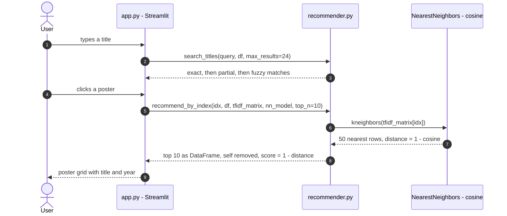
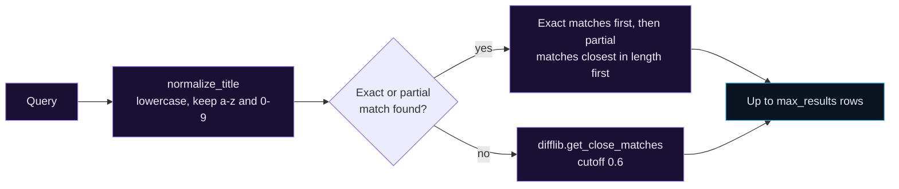

<div align="center">

<h1>FilmSense</h1>

<h3><i>Find Films. Feel More.</i></h3>

<p>
Content-based movie recommendations built from weighted metadata, TF-IDF vectors and<br>
cosine nearest-neighbour search, served through a Streamlit web app.
</p>

<p>
  
  
  
  
  
</p>

<p>
  <a href="#overview">Overview</a> &nbsp;·&nbsp;
  <a href="#system-architecture">Architecture</a> &nbsp;·&nbsp;
  <a href="#how-it-works">How it works</a> &nbsp;·&nbsp;
  <a href="#dataset-and-data-processing">Dataset</a> &nbsp;·&nbsp;
  <a href="#installation-and-setup">Setup</a> &nbsp;·&nbsp;
  <a href="#results-and-evaluation">Results</a> &nbsp;·&nbsp;
  <a href="#limitations-and-known-issues">Limitations</a>
</p>

<table>
  <tr>
    <td align="center" width="25%"><b>3,911</b><br><sub>films in the curated catalogue</sub></td>
    <td align="center" width="25%"><b>27,548</b><br><sub>TF-IDF vocabulary terms</sub></td>
    <td align="center" width="25%"><b>Cosine</b><br><sub>exact brute-force kNN</sub></td>
    <td align="center" width="25%"><b>Top 10</b><br><sub>ranked films per title</sub></td>
  </tr>
</table>

</div>

---

## Overview

You often know a film you enjoyed but not what to watch next. FilmSense answers that single question: **search for a movie, and get the ten catalogue films whose metadata is most similar to it.**

Similarity is measured on what the films are made of: genres, thematic keywords, director, billed cast, producers, production companies and the plot overview. Each film is turned into a weighted TF-IDF vector, and the nearest vectors under cosine distance are returned.

| | |
|---|---|
| **Input** | A movie title. Matching tolerates case, punctuation, partial titles and small typos. |
| **Output** | Ten ranked films with similarity score, TMDB rating, IMDb rating (where available), release year, runtime, poster and backdrop. |
| **Who it is for** | Viewers looking for "something like *X*", and developers or students who want a compact, readable reference for a TF-IDF + nearest-neighbour pipeline. |
| **Why this approach** | It needs no user-interaction data, so there is no user cold-start problem. The result is easy to explain (shared genres, keywords and people), and at 3,911 items exhaustive search is simple and exact. |
| **Practical profile** | No API keys or accounts. The whole index is loaded into memory once per server process. Poster images are fetched from the TMDB image CDN at run time. |

---

## Key Features

<table>
  <tr>
    <td width="33%" valign="top">
      <b>Layered title search</b><br>
      Exact, then partial, then fuzzy matching (<code>difflib</code>, cutoff 0.6) over normalised titles, with a numbered picker in the CLI and a poster grid in the app.
    </td>
    <td width="33%" valign="top">
      <b>Weighted metadata features</b><br>
      Genres, keywords and director count three times; the four billed cast fields count twice; producers, production companies and overview count once.
    </td>
    <td width="33%" valign="top">
      <b>Cosine nearest-neighbour retrieval</b><br>
      <code>NearestNeighbors(metric="cosine", algorithm="brute")</code> over a sparse TF-IDF matrix. Scores are reported as <code>1 − cosine distance</code>.
    </td>
  </tr>
  <tr>
    <td valign="top">
      <b>Chained exploration</b><br>
      Click any recommended poster to make it the new query and keep following the graph from film to film.
    </td>
    <td valign="top">
      <b>Detail view</b><br>
      Backdrop, poster, TMDB and IMDb rating pills, release year and runtime for the selected film.
    </td>
    <td valign="top">
      <b>Browse modes and CLI</b><br>
      <i>Trending Now</i>, <i>Explore</i> and <i>Top Rated</i> pages, plus a command-line interface in <code>src/recommender.py</code>.
    </td>
  </tr>
</table>

**Planned, not yet implemented:** a *Genres* page and a *Watchlist*. Both pages exist in the sidebar as "Coming Soon" placeholders, and the *Add to Watchlist* button currently shows a notice only.

---

## Application Preview

The Streamlit app uses a light sage-green theme (Poppins and Inter fonts) with a persistent sidebar.

| Page | Status | What it does |
|---|---|---|
| **Home** | Implemented | Title search, *Trending Now* grid, match picker, selected-film detail panel and the *Recommended For You* grid. |
| **Explore** | Implemented | 15 random films with a *Shuffle* button. Clicking a poster jumps to Home with that film selected. |
| **Top Rated** | Implemented | The 15 films with the highest TMDB `vote_average` in the catalogue. |
| **Genres** | Placeholder | "Coming Soon". |
| **Watchlist** | Placeholder | "Coming Soon". |
| **About** | Implemented | Short project description. |

*Trending Now* is a random sample of 10 from the 30 most-voted films in the catalogue. It is not a time-based trend signal.

---

## System Architecture

The system has two halves. An **offline build** (three notebooks) turns a large raw metadata file into three persisted artifacts. A **runtime** layer (`recommender.py` and `app.py`) loads those artifacts once and answers queries from memory.

```mermaid
flowchart LR
    classDef data fill:#0b1220,stroke:#38bdf8,stroke-width:1.5px,color:#e2e8f0
    classDef proc fill:#1a1033,stroke:#a78bfa,stroke-width:1.5px,color:#ede9fe
    classDef app  fill:#0f172a,stroke:#e879f9,stroke-width:1.5px,color:#fdf4ff

    subgraph BUILD["Offline build - notebooks"]
        direction LR
        RAW[("Raw IMDB + TMDB<br/>metadata CSV<br/>1,072,255 rows")]:::data
        FILTER["Filter<br/>runtime 70-250 min<br/>vote_count >= 1,000"]:::proc
        TAGS["combine_features<br/>weighted token repetition<br/>produces tags"]:::proc
        TFIDF["TfidfVectorizer<br/>27,548 terms"]:::proc
        NN["NearestNeighbors<br/>cosine, brute force"]:::proc
        RAW --> FILTER --> TAGS --> TFIDF --> NN
    end

    subgraph STORE["Persisted artifacts"]
        direction TB
        CSV[("data/<br/>Final_Dataset_2.csv")]:::data
        MAT[("models/<br/>tfidf_matrix2.npz")]:::data
        PKL[("models/<br/>nearest_neighbors2.pkl")]:::data
    end

    subgraph RUN["Runtime"]
        direction TB
        UI["app.py<br/>Streamlit UI"]:::app
        REC["src/recommender.py<br/>search, kNN, formatting"]:::app
        UI <--> REC
    end

    BUILD -. writes .-> STORE
    STORE -->|loaded once via cache_resource| RUN
```



| Component | Responsibility | Data in → out |
|---|---|---|
| `Secondary_Dataset_preparation.ipynb` | Trims the raw file to 3,911 films and builds the `tags` text column. | Raw CSV → `Final_Dataset_2.csv` |
| `TF-IDF.ipynb` | Vectorises `tags`. | `tags` → `tfidf_matrix2.npz`, `tfidf_vectorizer2.pkl` |
| `Recommendation_Engine.ipynb` | Fits the nearest-neighbour index (see the "Dataset 2" section of the notebook). | `tfidf_matrix2.npz` → `nearest_neighbors2.pkl` |
| `src/recommender.py` | Loads artifacts, resolves titles, runs the kNN query, formats results; also the CLI. | Title → ranked DataFrame |
| `app.py` | Streamlit pages, session state, styling, poster grids. | User clicks → rendered grids |

### What happens on a request



---

## How It Works

### Build stages

| # | Stage | Enters | Processing and reason | Output |
|---|---|---|---|---|
| 1 | **Filter the catalogue** | Raw CSV, 1,072,255 rows, 42 columns | Unused columns are dropped, then rows are kept only if `70 <= runtime <= 250` minutes and `vote_count >= 1000`. The thresholds remove shorts, extremely long titles and films with too few votes for their ratings to mean much. | 3,911 rows |
| 2 | **Build `tags`** | Ten text fields per film | `combine_features()` splits each field into alphabetic tokens and repeats them by weight (below), then joins everything into one string. Repetition raises a field's term frequency, so important fields dominate similarity. | `tags` column |
| 3 | **Vectorise** | `tags` | `TfidfVectorizer(stop_words="english")` turns each film into a sparse, L2-normalised vector. Common terms are down-weighted, rare shared terms (a director, a distinctive keyword) are up-weighted. | 3,911 × 27,548 sparse matrix |
| 4 | **Index** | TF-IDF matrix | `NearestNeighbors(metric="cosine", algorithm="brute", n_neighbors=50)` is fitted and pickled. | `nearest_neighbors2.pkl` |

**Feature weights** (`feature_weights` in `Secondary_Dataset_preparation.ipynb`):

| Field | Weight |
|---|:---:|
| `genres_list`, `keywords`, `Director` | 3 |
| `Star1`, `Star2`, `Star3`, `Star4` | 2 |
| `Producers`, `production_companies`, `overview` | 1 |

For example, the printed `tags` for *Gone with the Wind* in the notebook begins `Drama War Romance Drama War Romance Drama War …`: the three genre tokens repeated three times.

### Query stages

| # | Stage | Processing | Output |
|---|---|---|---|
| 5 | **Load** | `load_artifacts()` reads the CSV, the sparse matrix and the pickled model, and asserts that the CSV and matrix have the same row count. In the app it is wrapped in `@st.cache_resource`. | `df`, `tfidf_matrix`, `nn_model` |
| 6 | **Resolve title** | `search_titles()` normalises the query and matches it (see [Methodology](#recommendation-methodology)). | Matching rows |
| 7 | **Retrieve and rank** | `recommend_by_index()` calls `kneighbors` on the selected row, drops the film itself, converts distance to similarity, sorts descending and keeps `top_n`. | DataFrame of `title`, `similarity_score`, `vote_average`, `imdb_rating`, `release_year`, `poster_path` |
| 8 | **Render** | The app draws a poster grid. Poster paths are prefixed with `https://image.tmdb.org/t/p/w500` unless they already start with `http`. | Grid, click-through to the next query |

### The mathematics

**TF-IDF** (scikit-learn defaults, as used here):

$$
\text{tf-idf}(t,d)=\text{tf}(t,d)\cdot\text{idf}(t),\qquad
\text{idf}(t)=\ln\frac{1+n}{1+\text{df}(t)}+1
$$

- $t$ is a term and $d$ is one film's `tags` string.
- $\text{tf}(t,d)$ is how many times $t$ occurs in $d$. Because tokens were repeated by weight, a genre word with weight 3 contributes a count of 3.
- $n$ is the number of films (3,911) and $\text{df}(t)$ is the number of films whose `tags` contain $t$.
- Each resulting vector is then scaled to unit length (L2 norm).

**Cosine similarity** between two films with vectors $\mathbf{a}$ and $\mathbf{b}$:

$$
\cos(\mathbf{a},\mathbf{b})=\frac{\mathbf{a}\cdot\mathbf{b}}{\lVert\mathbf{a}\rVert\,\lVert\mathbf{b}\rVert}
$$

scikit-learn's `"cosine"` metric returns the distance $1-\cos(\mathbf{a},\mathbf{b})$, and the code reports `similarity_score = round(1 - distance, 4)`. TF-IDF vectors have no negative entries, so scores fall between 0 (no shared terms) and 1 (identical term profile). Because the vectors are unit length, cosine similarity equals the dot product.

---

## Dataset and Data Processing

**Source.** The notebooks read a single file named `IMDB TMDB Movie Metadata Big Dataset (1M).csv`, which combines TMDB-style columns (title, ratings, votes, runtime, overview, keywords, image paths) with IMDb-style columns (`IMDB_Rating`, `Meta_score`, `Star1`–`Star4`, `Director`). The notebooks do not record where it was downloaded from or under which licence, so check the original publisher's terms before redistributing the raw file or data derived from it. The raw file is only needed to regenerate the artifacts, not to run the app.

### Filtering funnel

| Step | Rows remaining |
|---|---:|
| Raw file | 1,072,255 |
| `runtime >= 70` | 403,286 |
| `runtime <= 250` | 398,152 |
| `vote_count >= 1000` | **3,911** (about 0.36% of the raw rows) |
| Drop rows without `poster_path` | 3,911 (no rows removed) |

The column count goes from 42 (raw) to 23 (after dropping unused columns) to 11 (after `tags` is built and the source text columns are removed).

### Final dataset: `Final_Dataset_2.csv`

| Column | Used for |
|---|---|
| `title` | Search and display |
| `vote_average`, `vote_count` | TMDB rating pill, *Top Rated* sort, *Trending Now* pool |
| `IMDB_Rating` | IMDb rating pill (shown as "N/A" when missing) |
| `release_year`, `runtime` | Year and runtime labels |
| `poster_path`, `backdrop_path` | Poster and backdrop images |
| `tags` | Build-time input to TF-IDF only |
| `id`, `imdb_id` | Retained identifiers, not used at run time |

The CSV also contains a leading unnamed index column, because `to_csv` was called without `index=False`. It is ignored by the app.

### Missing values and feature coverage

After filtering, the only column with missing values among those kept in the final table is `IMDB_Rating` (817 of 3,911, about 21%). The text inputs to `tags` are less complete:

| Field | Films with a value | Share |
|---|---:|---:|
| `genres_list`, `keywords`, `overview`, `Director` | 3,911 | 100% (non-null) |
| `production_companies` | 3,907 | 99.9% |
| `Star1` | 3,094 | 79.1% |
| `Producers` | 2,273 | 58.1% |
| `Star2`, `Star3`, `Star4` | 611 | 15.6% |

Missing values are treated as empty and contribute no tokens.

**Data-quality observation (cause not verified).** In the rows printed by the notebook, some `Star` values do not look like billed actors. *Gone with the Wind* lists directors in `Star1` and `Star2`, and *Zack Snyder's Justice League* lists an actor who is not in the film as `Star1`. The cast columns deserve an audit before they are given further weight.

---

## Recommendation Methodology

FilmSense is a **content-based** recommender. It uses no ratings from users, no viewing history and no collaborative signal, and it does not personalise results per user.

**Input representation.** The query is a row of the catalogue, identified by its row index. The row's TF-IDF vector is the query vector.

**Features.** Ten metadata fields, merged into one bag of words (weights above). Tokens are alphabetic only (`re.split(r"[^a-zA-Z]+", ...)`), so digits are discarded, and multi-word names such as a director's name become separate tokens. `TfidfVectorizer` then lowercases, removes English stop words and ignores single-character tokens.

**Candidate comparison.** `NearestNeighbors` with `algorithm="brute"` computes the cosine distance from the query to every film. It is exact (no approximation). It was fitted with `n_neighbors=50`, so each query retrieves 50 rows including the film itself.

**Ranking and top-N.** The film itself is removed, scores are computed as `1 - distance`, the rows are sorted by score and the first `top_n` are returned (default 10). Since 50 neighbours are retrieved and one is removed, `top_n` is effectively capped at 49.

**Title resolution.** `search_titles()` works on titles normalised to lowercase letters and digits with all other characters removed:



An empty or punctuation-only query, or a query with no match, returns an empty result. The CLI prints "No movies found" and the app shows a warning.

**Strengths.** Transparent and explainable. Works for every film in the catalogue with no usage data. Small memory footprint (sparse matrix). Weights are a single dictionary that is easy to tune.

**Weaknesses.** See [Limitations](#limitations-and-known-issues): bag-of-words has no notion of meaning, the catalogue is fixed and popularity-filtered, and recommendation quality has not yet been measured.

---

## Technology Stack

| Component | Technology | Actual role |
|---|---|---|
| Language | Python (notebooks ran on 3.13.9) | Whole pipeline and app |
| Data handling | pandas | CSV I/O, filtering, feature construction, result tables |
| Sparse storage | SciPy (`scipy.sparse`) | `save_npz` / `load_npz` for the TF-IDF matrix |
| Vectorisation | scikit-learn `TfidfVectorizer` | Weighted bag-of-words to TF-IDF vectors |
| Retrieval | scikit-learn `NearestNeighbors` | Exact cosine kNN, brute force |
| Fuzzy matching | `difflib` (standard library) | Typo-tolerant title search |
| Persistence | `pickle`, `.npz` | Saved model and sparse matrix |
| Interface | Streamlit | Pages, session state, `st.cache_resource`, poster grids, custom CSS |
| Remote assets | TMDB image CDN, Google Fonts | Posters and backdrops; Poppins and Inter |
| Experimentation | Jupyter notebooks | Dataset preparation, vectorisation, index fitting |

The project reads image files from the TMDB CDN but does not call the TMDB API.

---

## Project Structure

*Partial structure, reconstructed from the path logic in `app.py` and `recommender.py` and from the supplied notebooks.*

```text
FilmSense/
├── app.py                         # Streamlit app (entry point)
├── requirements.txt               # dependency manifest
├── Assets/
│   └── Logo.png                   # page icon and sidebar logo (required by app.py)
├── src/
│   └── recommender.py             # artifact loading, title search, kNN, CLI
├── data/
│   └── Final_Dataset_2.csv        # 3,911 films
├── models/
│   ├── tfidf_matrix2.npz          # sparse TF-IDF matrix (3,911 x 27,548)
│   ├── nearest_neighbors2.pkl     # fitted NearestNeighbors model
│   └── tfidf_vectorizer2.pkl      # saved by TF-IDF.ipynb, not loaded at run time
└── notebooks/
    ├── Secondary_Dataset_preparation.ipynb
    ├── TF-IDF.ipynb
    └── Recommendation_Engine.ipynb
```

---

## Installation and Setup

**Prerequisites:** Python 3 (the notebooks were run on 3.13.9), Git, and an internet connection for poster images and web fonts.

**Windows PowerShell**

```powershell
git clone https://github.com/<your-username>/FilmSense.git
cd FilmSense

python -m venv .venv
.\.venv\Scripts\Activate.ps1

python -m pip install --upgrade pip
pip install -r requirements.txt

streamlit run app.py
```

If PowerShell blocks the activation script, allow it for the current session only:

```powershell
Set-ExecutionPolicy -Scope Process -ExecutionPolicy Bypass
```

<details>
<summary><b>Linux / macOS</b></summary>

```bash
git clone https://github.com/<your-username>/FilmSense.git
cd FilmSense

python3 -m venv .venv
source .venv/bin/activate

python -m pip install --upgrade pip
pip install -r requirements.txt

streamlit run app.py
```

</details>

The app expects the artifacts and logo listed under [Configuration and Data Requirements](#configuration-and-data-requirements) to be in place. Streamlit opens the app in your browser, by default at `http://localhost:8501`.

---

## Quick Start

```powershell
git clone https://github.com/<your-username>/FilmSense.git
cd FilmSense
python -m venv .venv; .\.venv\Scripts\Activate.ps1
pip install -r requirements.txt
streamlit run app.py
```

Command-line alternative, with no browser:

```powershell
python src\recommender.py "Inception" --top_n 5
```

---

## Usage Examples

### Web app

1. Open **Home** and type a title in the search box.
2. Pick the right film from *Matches Found* (up to 24 matches, six per row).
3. Read the detail panel, then browse *Recommended For You*.
4. Click any recommended poster to continue from that film. **New Search** in the sidebar resets everything.

### Command line

```powershell
python src\recommender.py "Inception" --top_n 5
```

If more than one film matches, the CLI lists them and asks you to pick a number. The output has this structure (values are placeholders, not a recorded run):

```text
============= Top 5 recommendations for '<title>' =============

<n>. <recommended title>
   Similarity  : 0.xxxx
   TMDB Rating : x.x/10
   IMDB Rating : x.x/10
   Released    : yyyy
   Poster      : <poster path or URL>
```

### Python

```python
import sys
sys.path.append("src")

from recommender import load_artifacts, search_titles, recommend_by_index

df, tfidf_matrix, nn_model = load_artifacts()

matches = search_titles("Inception", df)          # exact, then partial, then fuzzy
if matches.empty:
    raise SystemExit("No match found")

idx = matches.index[0]                            # row label of the first match
recs = recommend_by_index(idx, df, tfidf_matrix, nn_model, top_n=10)
print(recs[["title", "similarity_score", "vote_average", "release_year"]])
```

---

## Results and Evaluation

**No quantitative evaluation of the shipped model has been performed yet.** There are no recorded precision, recall, NDCG, latency or user-study results, so none are reported here.

| Aspect | Status |
|---|---|
| Ranked retrieval by cosine similarity | Implemented |
| Offline ranking metrics (e.g. precision@k, NDCG) | Not computed |
| Latency / throughput | Not measured |
| User feedback or A/B comparison | Not conducted |

`similarity_score` is a measure of **metadata overlap**, not a prediction of enjoyment. A high score means two films share many weighted terms; it does not mean the user will like both.

<details>
<summary><b>Development note: an earlier full-catalogue prototype (not used by the app)</b></summary>

`Recommendation_Engine.ipynb` also contains a first prototype that indexed a larger table (367,703 rows, 7 columns) with a 50,000-term TF-IDF matrix. The scripts that produced that table were not part of this repository's reviewed files, and the app does not use it. One recorded query for *Interstellar* returned these results:

| Rank | Title | Similarity | `vote_average` |
|---:|---|---:|---:|
| 1 | To an Asteroid and Back | 0.2679 | 0.000 |
| 2 | The Martian | 0.2167 | 8.000 |
| 3 | Emergency! [Pilot] | 0.1990 | 8.000 |
| 4 | Above and Beyond: NASA's Journey to Tomorrow | 0.1828 | 7.700 |
| 5 | Inside 'Interstellar' | 0.1801 | 6.917 |
| 6 | The Last Days of Earth | 0.1800 | 0.000 |
| 7 | The Flying Painter | 0.1776 | 7.000 |
| 8 | Brother in Every Inch | 0.1747 | 6.300 |
| 9 | Space Captain: Captain of Space! | 0.1739 | 10.000 |
| 10 | Passengers | 0.1696 | 6.956 |

This is a single query on a different dataset and is **not** a measurement of the current model. It is shown because it is the only recorded output, and because it illustrates how an unfiltered long tail (many titles with near-zero or very few votes) can crowd the results. The current pipeline restricts the catalogue to films with at least 1,000 votes.

</details>

---

## Configuration and Data Requirements

### Mandatory

| File | Location | Produced by | Needed by |
|---|---|---|---|
| `Final_Dataset_2.csv` | `data/` | `Secondary_Dataset_preparation.ipynb` | App and CLI |
| `tfidf_matrix2.npz` | `models/` | `TF-IDF.ipynb` | App and CLI |
| `nearest_neighbors2.pkl` | `models/` | `Recommendation_Engine.ipynb` ("Dataset 2" section) | App and CLI |
| `Logo.png` | `Assets/` | Project asset | App only |

`load_artifacts()` raises `FileNotFoundError` if the model pickle is missing and an `AssertionError` if the CSV and the matrix have different row counts. Keep the three data artifacts from the same build together.

No environment variables, API keys or secrets are required.

### Rebuilding the artifacts

1. Place the raw CSV where `Secondary_Dataset_preparation.ipynb` expects it and run the notebook. It writes `Final_Dataset_2.csv`.
2. Run `TF-IDF.ipynb`. It writes `tfidf_vectorizer2.pkl` and `tfidf_matrix2.npz`.
3. Run only the "Dataset 2" cell of `Recommendation_Engine.ipynb`. It writes `nearest_neighbors2.pkl`.
4. Copy the CSV into `data/` and the `.npz` and `.pkl` files into `models/`.

The notebooks read and write under a relative `../../Data/New/` folder (and the preparation notebook reads its raw file from a local path), so adjust those paths to your own layout and then move the outputs as in step 4.

### Optional customisation

| Setting | Where | Default |
|---|---|---|
| Recommendations shown | `REC_TOP_N` in `app.py` | 10 |
| Grid width, trending, explore and top-rated counts | `GRID_COLUMNS`, `TRENDING_COUNT`, `EXPLORE_COUNT`, `TOP_RATED_COUNT` in `app.py` | 5, 10, 15, 15 |
| Field weights | `feature_weights` in `Secondary_Dataset_preparation.ipynb` | See [How It Works](#how-it-works) |
| Fuzzy-match strictness | `fuzzy_cutoff` in `search_titles()` | 0.6 |
| Artifact file names | `DATASET_FILE`, `TFIDF_MATRIX_FILE`, `NN_MODEL_FILE` in `recommender.py` | `Final_Dataset_2.csv`, `tfidf_matrix2.npz`, `nearest_neighbors2.pkl` |

Changing the feature weights or the dataset requires re-running steps 1 to 3 above. If you raise `top_n` above 49, remember the model only retrieves 50 neighbours.

### Dependencies and compatibility

| Package | Used for |
|---|---|
| `streamlit` | Web app (`app.py` passes `width="stretch"` to `st.image` and `st.button`, which older Streamlit releases may not accept) |
| `pandas` | Data loading and result tables |
| `scipy` | Sparse matrix I/O |
| `scikit-learn` | TF-IDF and nearest neighbours |

A pickled scikit-learn model should be loaded with the same scikit-learn version that trained it. Pin the version in `requirements.txt` and rebuild `nearest_neighbors2.pkl` if you change it. Only load `.pkl` files that you built yourself or trust, because unpickling can execute arbitrary code.

---

## Limitations and Known Issues

| Limitation | Evidence | Status |
|---|---|---|
| **Content-only, no personalisation.** Every user gets the same list for the same film. | No user data or profiles in the code. | Confirmed |
| **Catalogue is small and popularity-filtered.** Only films with at least 1,000 TMDB votes and a 70 to 250 minute runtime are included, so recent, niche and obscure titles are absent. | Filter in the preparation notebook. | Confirmed |
| **Queries must be catalogue films.** There is no free-text query, and new films need a rebuild. The saved vectorizer is not used at run time. | `recommend_by_index` takes a row index. | Confirmed |
| **Bag-of-words has no semantics.** Synonyms and plot meaning are not captured, and names are split into single words, so a shared first name can create spurious overlap. | Tokenisation in `combine_features`. | Confirmed (design); impact on quality not measured |
| **Sparse cast data.** Only 15.6% of films have `Star2`–`Star4`, and some printed values look wrong. | Notebook null counts and printed rows. | Confirmed (counts); potential (wrong values) |
| **Recommendation quality is unmeasured.** | No evaluation code or results. | Confirmed |
| **CLI numbering.** `print_recommendations` prints the dataset row index plus one as the list number, not a 1 to N rank. The web app is unaffected. | `for rank, row in results.iterrows()` iterates the DataFrame index. | Confirmed (cosmetic) |
| **Partial title matching is loose.** Normalisation removes spaces, so a short query can match inside longer titles. Results are ordered by closeness in length. | `search_titles` and `normalize_title`. | Potential |
| **Titles are re-normalised on every search.** | `df['title'].apply(normalize_title)` runs per call. | Confirmed (minor cost at this size) |
| **Brute-force search scales linearly with catalogue size.** | `algorithm="brute"`. | Potential at larger sizes |
| **Network dependency for visuals.** Posters, backdrops, fallback placeholder and web fonts come from third-party hosts. | URLs in `app.py`. | Confirmed |
| **No explicit content filter.** The `adult` flag is dropped during preparation and nothing filters on it afterwards; the vote threshold is the only gate. | Preparation notebook. | Potential |
| **"Trending Now" is not time-based.** It samples the 30 most-voted films. | `render_home` in `app.py`. | Confirmed |
| **No automated tests.** | None supplied. | Confirmed |

---

## Future Improvements

*Proposals, in rough priority order. None of these are implemented.*

1. **Evaluate.** Define a protocol (for example genre or franchise agreement at k, or a small hand-labelled set) and report it here.
2. **Make builds reproducible.** Add pinned `requirements.txt`, repository-relative paths in the notebooks, `index=False` when writing the CSV, and a single script that rebuilds all artifacts.
3. **Audit the data.** Verify and repair the cast columns, and decide whether to filter adult titles explicitly.
4. **Tests.** Cover title normalisation and search, `recommend_by_index` row alignment, and artifact loading.
5. **Fix the CLI rank numbering** and precompute normalised titles once at load time.
6. **Finish the placeholder pages** (*Genres*, *Watchlist*).
7. **Richer similarity.** Try sentence embeddings for the overview, per-field vectors with learned weights, or a hybrid that blends in rating or popularity.
8. **Diversity-aware re-ranking** so that recommendations are not near-duplicates (sequels, remakes).
9. **Approximate nearest-neighbour search** if the catalogue grows well beyond the current size.

---

## Contributing

Contributions are welcome. The project does not yet have an automated test suite or CI, so please run the app and the CLI manually before opening a pull request.

```powershell
# 1. Fork the repository on GitHub, then clone your fork
git clone https://github.com/<your-username>/FilmSense.git
cd FilmSense

# 2. Create a branch
git checkout -b feature/short-description

# 3. Make your change, then commit
git add .
git commit -m "Describe the change"

# 4. Push and open a pull request against the main repository
git push origin feature/short-description
```

For bugs or ideas, open an issue and describe the input, the expected behaviour and what you observed.

---

## License and Acknowledgments

**License:** not yet specified. Until a `LICENSE` file is added to the repository, default copyright applies.

**Data.** Movie metadata, ratings and images originate from TMDB, and some rating and cast columns are IMDb-derived, as combined in the `IMDB TMDB Movie Metadata Big Dataset (1M).csv` file used for the build. FilmSense is not affiliated with or endorsed by TMDB or IMDb.

**Libraries.** [Streamlit](https://streamlit.io), [pandas](https://pandas.pydata.org), [SciPy](https://scipy.org) and [scikit-learn](https://scikit-learn.org).

**Author.** Created by Pankaj, an engineering student interested in machine learning, AI and Python, as a way to turn coursework into something people can use.
