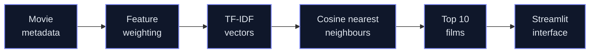

<p align="center">
  
</p>

<p align="center">
  <b>Type a movie title, get the ten most similar films.</b><br>
  Content-based filtering over weighted movie metadata, using TF-IDF and cosine similarity.
</p>

<p align="center">
  <a href="https://filmsense.streamlit.app/">
    
  </a>
  <br>
  <sub><a href="https://github.com/Pankaj-Jhajhria/Movie-Recommendation-System">View Source</a></sub>
</p>

<table align="center">
  <tr>
    <td align="center" width="200"><b>3,911</b><br><sub>films in the catalogue</sub></td>
    <td align="center" width="200"><b>27,548</b><br><sub>TF-IDF vocabulary terms</sub></td>
    <td align="center" width="200"><b>Top 10</b><br><sub>similar films by default</sub></td>
  </tr>
</table>

---

## Features

<table>
  <tr>
    <td width="50%" valign="top"><b>Forgiving title search</b><br>Exact, partial and fuzzy matching, so small typos and partial titles still find the film.</td>
    <td width="50%" valign="top"><b>Content-based recommendations</b><br>Genres, keywords, director, cast, producers, studios and overview, weighted by importance.</td>
  </tr>
  <tr>
    <td valign="top"><b>Ranked results with details</b><br>Similarity-ordered films with TMDB and IMDb ratings, year, runtime, poster and backdrop.</td>
    <td valign="top"><b>Browse and explore</b><br>Explore, Trending Now and Top Rated views; click any poster to continue from that film.</td>
  </tr>
</table>

## How it works



Each film's metadata is merged into one weighted text profile (genres, keywords and director count most) and turned into a TF-IDF vector. Films whose vectors point in similar directions share similar metadata, so the nearest neighbours of the film you pick under cosine similarity become your recommendations.

## Tech stack

`Python` · `pandas` · `SciPy` · `scikit-learn` · `Streamlit`

## Run locally

```powershell
git clone https://github.com/Pankaj-Jhajhria/Movie-Recommendation-System.git
cd Movie-Recommendation-System
python -m venv .venv
.\.venv\Scripts\Activate.ps1
python -m pip install -r requirements.txt
streamlit run app/app.py
```

Inside `app/`, the app expects `Assets/Logo.png`, `data/Final_Dataset_2.csv`, `models/tfidf_matrix2.npz` and `models/nearest_neighbors2.pkl`. The three notebooks rebuild the data and model files. Load the pickle with the scikit-learn version that created it, and keep an internet connection on, because posters come from the TMDB image CDN.

## Good to know

- FilmSense is a content-based recommender, not a personalized one: everyone gets the same list for the same film.
- No quantitative evaluation of recommendation quality has been performed yet.
- Data comes from an IMDb/TMDB-derived metadata set (1M-record file); its licence is not recorded in the project, so check the publisher's terms before reusing it. FilmSense is not affiliated with TMDB or IMDb.

---

<p align="center">
  <sub>Built by Pankaj · <a href="https://github.com/Pankaj-Jhajhria/Movie-Recommendation-System">Pankaj-Jhajhria/Movie-Recommendation-System</a></sub>
</p>
